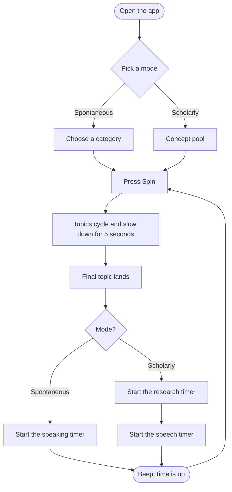
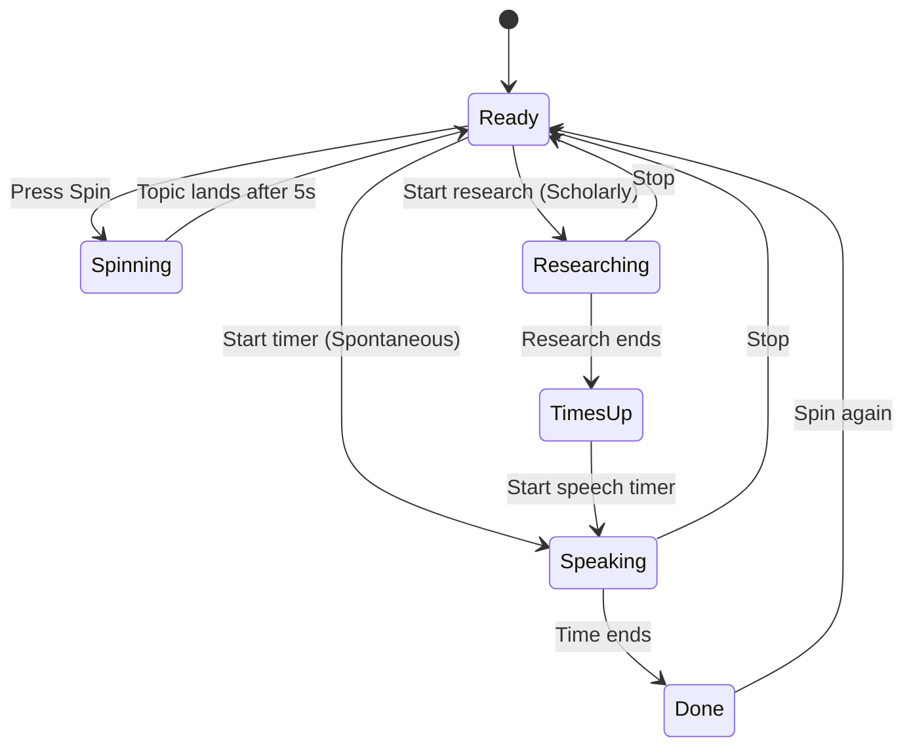
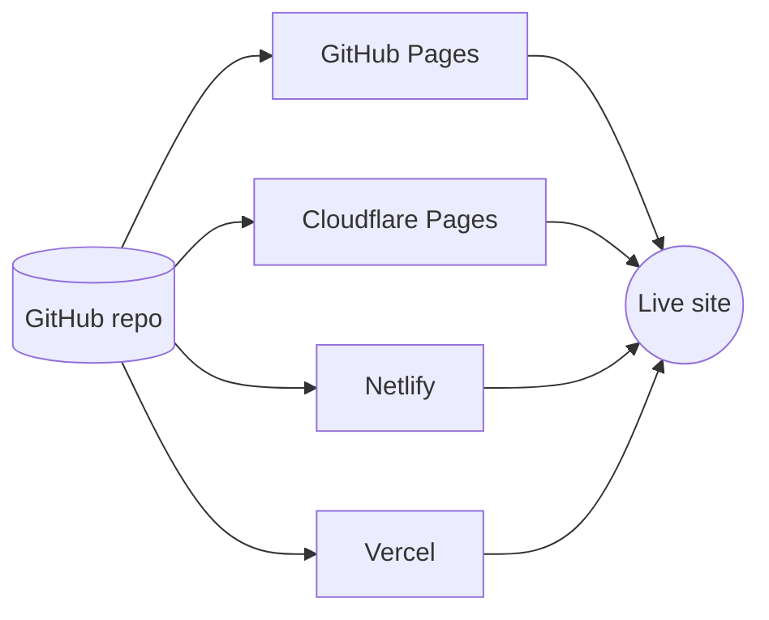
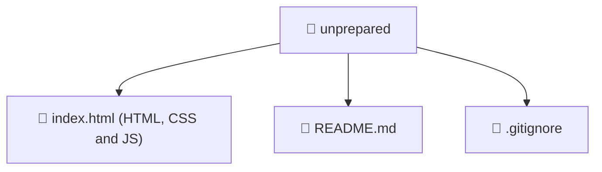

<div align="center">

# 🎤 Unprepared

**Spin a topic. Start the timer. Speak.**

A tiny speaking-practice app for thinking on your feet, with two modes, ten dark themes and zero dependencies.


</div>

---

## ✨ Features

- 🧠 **Spontaneous mode:** a short, random topic from the category you choose, plus a quick speaking timer. Minimal prep.
- 🔍 **Scholarly mode:** a deeper concept (for example *The compromise effect*), a research timer, then a separate speech timer.
- 🎰 **Slot-machine spin:** topics flash past and slow down, then land on one after exactly 5 seconds.
- 🗂️ **9 categories:** General, Personal finance, Entrepreneurship, Startups, Tech / AI, Fitness, Nutrition, Productivity and History.
- ⏱️ **Custom timers:** set your own spontaneous, research and speech durations. A soft beep marks the end.
- 🎨 **10 dark themes:** Arctic (default), Ember, Midnight, Plum, Ocean, Graphite, Crimson, Forest, Sunset and Lavender.
- 💾 **Remembers your settings** (timers and theme) in your browser.
- 📱 **Responsive**, with safe-area support for phones.

---

## 🧭 How it works



### ⏲️ Timer states



---

## 🚀 Quick start

No install and no build step. The whole app is one file.

```bash
# 1. Clone the repo
git clone https://github.com/<your-username>/unprepared.git
cd unprepared

# 2. Open it in your browser
open index.html        # macOS
xdg-open index.html    # Linux
start index.html       # Windows
```

> 💡 If your file is called `unprepared.html`, rename it to `index.html` so hosting platforms serve it automatically.

---

## 🌐 Deploy for free

Because it is a static site, it works on any static host.



**GitHub Pages:** go to *Settings → Pages*, choose the `main` branch and the `/ (root)` folder, then save.
**Cloudflare Pages, Netlify or Vercel:** import the repo and leave the build command empty. The output directory is the repo root.

---

## 🛠️ Customize

Everything lives in `index.html`.

| What | Where to look |
|---|---|
| ✏️ Spontaneous topics | the `CATS` object in the script |
| 🎓 Scholarly concepts | the `SCHOL` array in the script |
| 🎨 Theme colours | the `:root[data-theme=...]` blocks in the CSS |
| 🧊 Default theme | the first `:root{...}` block |
| 🎰 Spin duration | `DUR=5000` (milliseconds) in the Spin handler |
| 🔗 Handle and link | search for `thvividx` |

### Add a new category

```js
"Travel": ["✈️", ["Lost Luggage", "Window Seat", "Street Maps", "Jet Lag"]],
```

### Add a new theme

```css
:root[data-theme=mint]{--bg:#0b1512;--glow1:#14402f;--glow2:#12303a;--accent:#6ee7b7;--ink:#04201a;--text:#e6f8f0;--muted:#8fb3a6;--panel:#101c18}
```

Then add `["mint","#6ee7b7","#12303a","Mint"]` to the `THEMES` array so it shows up in settings.

---

## 🗂️ Project structure



---

## 🧰 Built with

- Vanilla HTML, CSS and JavaScript
- [Fraunces](https://fonts.google.com/specimen/Fraunces) and [Outfit](https://fonts.google.com/specimen/Outfit) from Google Fonts
- Web Audio API for the end-of-timer beep
- `localStorage` for saved settings

---

## 👤 Author

Made by [@thvividx](https://instagram.com/thvividx)

---

## 📄 License

Add a license of your choice, for example [MIT](https://choosealicense.com/licenses/mit/).
